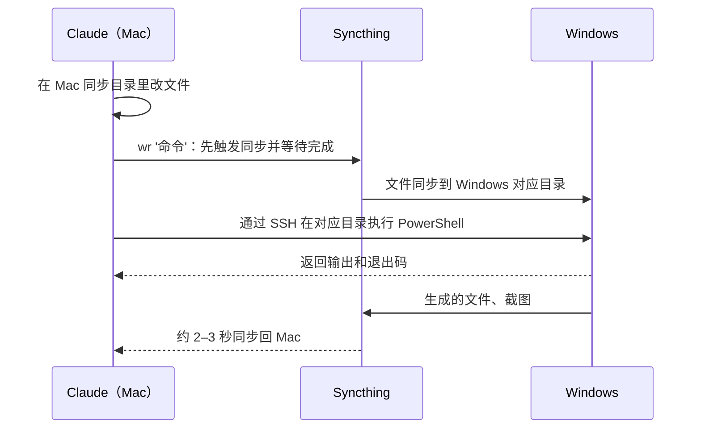

# mac2win-remote

让 Mac 上的 Claude Code 远程使用一台 Windows 电脑：跑命令、构建测试、运行桌面软件、操作界面、截图。

## 一、工作方式

文件在 Mac 上改，命令在 Windows 上跑。两边的代码目录由 Syncthing（文件同步工具）实时双向同步。



## 二、常用命令

| 命令 | 作用 |
|---|---|
| `wr '<PowerShell>'` | 在当前目录对应的 Windows 目录执行命令 |
| `wsh '<PowerShell>'` | 在 Windows 上执行系统级命令，不切换目录 |
| `wshot [名]` | 截 Windows 屏幕，输出 Mac 本地图片路径 |
| `wr-flush` | 立即同步，并等 Windows 收到 |

后台常驻进程、桌面界面操作等用法见 `SKILL.md`。

## 三、目录结构

| 目录 | 内容 |
|---|---|
| `SKILL.md` | 给 AI 读的使用说明 |
| `install.sh` | 把本目录作为技能链接到 `~/.claude/skills/mac2win-remote`（安装或覆盖更新） |
| `mac2win-remote搭建教程.md` | 从零搭建的完整步骤 |
| `scripts/mac/` | Mac 端命令，装到 PATH 里 |
| `scripts/windows/` | Windows 端脚本，装到 `$WR_TOOLS`（含加固脚本 `Harden-Windows.ps1` 与 sshd 自愈 `Repair-Sshd.ps1`） |

## 四、安装

首次使用按 `mac2win-remote搭建教程.md` 完成搭建。之后分两部分更新，都在本目录下执行：

技能说明（`SKILL.md`）：

```bash
./install.sh --dry-run   # 先看
./install.sh             # 安装或覆盖更新：链接到 ~/.claude/skills，已有同名项会被替换（真实目录先备份到 ~/.claude/skills-backup/）
```

链接到本目录后，修改 `SKILL.md` 立即生效。原链接指向的内容（例如技能管理工具复制出来的副本）保留但不再使用；若该工具之后重新同步把链接改了回去，重跑 `./install.sh` 即可。

命令与 Windows 端脚本（`scripts/` 有改动时）：

```bash
. ~/.config/wr/env
install -m 755 scripts/mac/* ~/.local/bin/
scp -q scripts/windows/*.ps1 "$WR_HOST:$(printf '%s' "$WR_TOOLS" | tr '\\' '/')/"
```

首次安装或脚本有更新后，在 Windows 上应用加固并注册 sshd 自愈任务（可重复执行）：

```bash
wsh 'Harden-Windows.ps1; Repair-Sshd.ps1 -Register'
```
