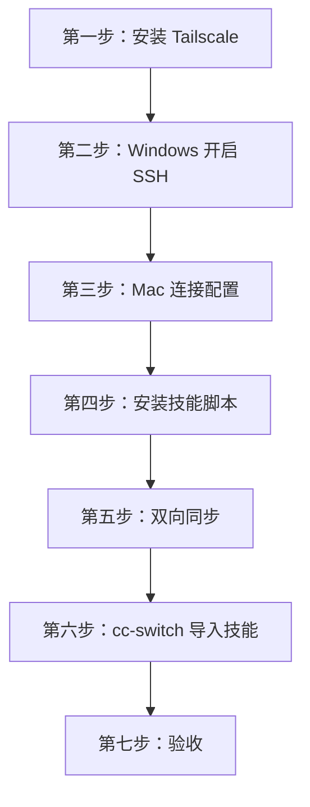
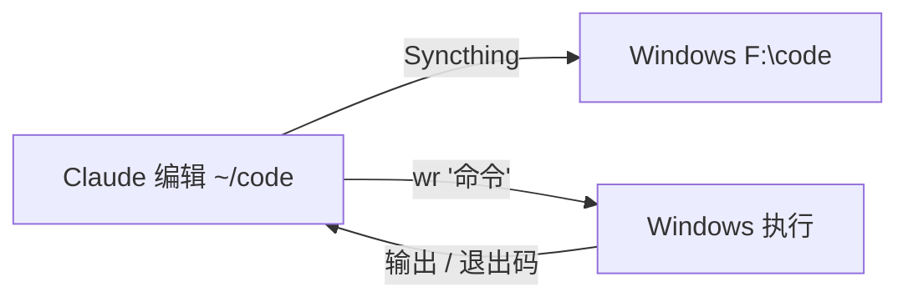

# Windows 远程运行机搭建教程

Mac 上写代码（Claude Code），Windows 上执行。按顺序做，看到 ✅ 再进入下一步。



搭建完成后的日常使用：



## 搭建完成后各文件的位置

| 位置 | 内容 |
|---|---|
| `~/.ssh/id_ed25519_win` | 连接 Windows 用的钥匙（没有口令） |
| `~/.ssh/config` | `Host win` 连接配置 |
| `~/.config/wr/env` | 脚本使用的环境变量（见第三步、第五步） |
| `~/.local/bin/` | `wr` `wr-flush` `wsh` `wshot` |
| `C:\tools\` | Windows 端脚本 |
| `~/code` ⇄ `F:\code` | 双向同步的代码目录 |
| `~/.cc-switch/skills/mac2win-remote` | AI 技能（由 cc-switch 管理，软链接到 `~/.claude/skills/`） |

---

## 第一步：安装 Tailscale

| 机器 | 操作 |
|---|---|
| Windows | `winget install --id Tailscale.Tailscale -e`，安装后登录；托盘图标 → Settings → 勾选 **Run unattended** |
| Mac | `brew install --cask tailscale`，用**同一个账号**登录 |

✅ 在 Mac 上执行 `tailscale status`，能看到 Windows，记下它的 `100.x.x.x` IP

## 第二步：Windows 开启 SSH

在 Mac 上生成钥匙，并把公钥复制到剪贴板：

```bash
ssh-keygen -q -t ed25519 -N "" -C mac-to-win -f ~/.ssh/id_ed25519_win && pbcopy < ~/.ssh/id_ed25519_win.pub
```

在 Windows 上打开**管理员 PowerShell**，把第一行改成你的公钥，然后整段粘贴执行：

```powershell
$PubKey = '这里粘贴公钥'
$wg = '-e','--accept-source-agreements','--accept-package-agreements','--disable-interactivity'
if (-not (Get-Command pwsh -EA SilentlyContinue)) { winget install --id Microsoft.PowerShell @wg }
if (-not (Get-Service sshd -EA SilentlyContinue)) {
  try { Add-WindowsCapability -Online -Name OpenSSH.Server~~~~0.0.1.0 | Out-Null } catch {}
  if (-not (Get-Service sshd -EA SilentlyContinue)) { winget install --id Microsoft.OpenSSH.Preview @wg }
}
Set-Service sshd -StartupType Automatic; Start-Service sshd; Start-Sleep 2
$ak = 'C:\ProgramData\ssh\administrators_authorized_keys'
if (-not ((Test-Path $ak) -and (Select-String -LiteralPath $ak -SimpleMatch $PubKey -Quiet))) { Add-Content $ak $PubKey -Encoding ascii }
icacls $ak /inheritance:r /grant 'Administrators:F' /grant 'SYSTEM:F' | Out-Null
$cfg = 'C:\ProgramData\ssh\sshd_config'
(Get-Content $cfg) -replace '^#?\s*PasswordAuthentication\s+\w+','PasswordAuthentication no' | Set-Content $cfg -Encoding ascii
Get-NetFirewallRule | ? { $_.Name -eq 'OpenSSH-Server-In-TCP' -or $_.DisplayName -like '*SSH*' } | Remove-NetFirewallRule
New-NetFirewallRule -Name 'OpenSSH-Server-In-TCP' -DisplayName 'OpenSSH (Tailscale only)' -Direction Inbound -Protocol TCP -LocalPort 22 -RemoteAddress 100.64.0.0/10 -Action Allow -Profile Any | Out-Null
Restart-Service sshd
"OK  用户名: $env:USERNAME  Tailscale IP: $(& 'C:\Program Files\Tailscale\tailscale.exe' ip -4)"
```

✅ 输出 `OK  用户名: xxx  Tailscale IP: 100.x.x.x`

## 第三步：Mac 连接配置

把第一行改成你的值，然后执行：

```bash
WIN_IP=100.x.x.x  WIN_USER=<Windows用户名>  WIN_ROOT='F:\code'  WIN_TOOLS='C:\tools'
mkdir -p ~/.ssh/cm ~/.config/wr
grep -q '^Host win$' ~/.ssh/config 2>/dev/null || cat >> ~/.ssh/config <<EOF

Host win
  HostName $WIN_IP
  User $WIN_USER
  IdentityFile ~/.ssh/id_ed25519_win
  IdentitiesOnly yes
  ControlMaster auto
  ControlPath ~/.ssh/cm/%C
  ControlPersist 10m
  ServerAliveInterval 30
EOF
cat > ~/.config/wr/env <<EOF
WIN_IP=$WIN_IP
WR_HOST=win
WR_LOCAL_ROOT="\$HOME/code"
WR_REMOTE_ROOT='$WIN_ROOT'
WR_TOOLS='$WIN_TOOLS'
WR_FLUSH=wr-flush
ST_URL=http://127.0.0.1:8384
ST_FOLDER=code
EOF
chmod 600 ~/.ssh/config ~/.config/wr/env
ssh -o StrictHostKeyChecking=accept-new win 'echo ok'
```

`~/.config/wr/env` 里的变量：

| 变量 | 含义 |
|---|---|
| `WIN_IP` | Windows 的 Tailscale IP（地址直接写 IP，不依赖 DNS） |
| `WR_HOST` | SSH 别名 |
| `WR_LOCAL_ROOT` / `WR_REMOTE_ROOT` | Mac / Windows 两边的代码根目录 |
| `WR_TOOLS` | Windows 工具目录（`wr` / `wsh` 会把它加进 PATH） |
| `WR_FLUSH` | 执行前等待同步的命令（设成 `true` 就不等待） |
| `ST_URL` / `ST_FOLDER` | Mac 端 Syncthing 的地址 / 同步文件夹 ID |
| `ST_DEVICE` / `ST_KEY` | Windows 端的设备 ID / Mac 端的 API Key（第五步自动写入） |

✅ 输出 `ok`

## 第四步：安装技能脚本

```bash
. ~/.config/wr/env
cd "<mac2win-remote 仓库路径>"
mkdir -p ~/.local/bin && install -m 755 scripts/mac/* ~/.local/bin/
grep -q '.local/bin' ~/.zshrc || echo 'export PATH="$HOME/.local/bin:$PATH"' >> ~/.zshrc
export PATH="$HOME/.local/bin:$PATH"
command -v jq >/dev/null || brew install jq
wsh "New-Item -ItemType Directory -Force '$WR_TOOLS' | Out-Null"
scp -q scripts/windows/*.ps1 "$WR_HOST:$(printf '%s' "$WR_TOOLS" | tr '\\' '/')/"
wsh "(Get-ChildItem '$WR_TOOLS').Name -join ', '"
```

✅ 列出 `Gui.ps1, Harden-Windows.ps1, Invoke-Interactive.ps1, Repair-Sshd.ps1, Screenshot.ps1, Start-Interactive.ps1, Stop-Interactive.ps1`

再做一次 Windows 加固（防自动更新重启、睡眠打断长任务）并注册 sshd 自愈任务；两条都可重复执行：

```bash
wsh 'Harden-Windows.ps1; Repair-Sshd.ps1 -Register'
```

## 第五步：双向同步

**① Windows 端**：创建代码目录，安装 Syncthing 并设为登录后自动启动；防火墙的 22000 端口和 3000–9999 端口只对 Tailscale 网段开放。

```bash
. ~/.config/wr/env
{ printf '$CodeRoot = %s\n' "'$WR_REMOTE_ROOT'"; cat <<'PS'
$ErrorActionPreference = 'Stop'
$me = [Security.Principal.WindowsIdentity]::GetCurrent().Name
New-Item -ItemType Directory -Force $CodeRoot | Out-Null

# Syncthing
$find = { Get-ChildItem "$env:LOCALAPPDATA\Microsoft\WinGet\Packages" -Recurse -Filter syncthing.exe -EA SilentlyContinue | Select-Object -First 1 -ExpandProperty FullName }
$st = & $find
if (-not $st) {
  winget install --id Syncthing.Syncthing -e --accept-source-agreements --accept-package-agreements --disable-interactivity | Out-Null
  $st = & $find
}
if (-not (Get-ScheduledTask Syncthing -EA SilentlyContinue)) {
  Register-ScheduledTask -TaskName 'Syncthing' `
    -Action    (New-ScheduledTaskAction -Execute $st -Argument '--no-console --no-browser') `
    -Trigger   (New-ScheduledTaskTrigger -AtLogOn -User $me) `
    -Principal (New-ScheduledTaskPrincipal -UserId $me -LogonType Interactive) `
    -Settings  (New-ScheduledTaskSettingsSet -AllowStartIfOnBatteries -DontStopIfGoingOnBatteries -ExecutionTimeLimit ([TimeSpan]::Zero)) | Out-Null
}
if (-not (Get-Process syncthing -EA SilentlyContinue)) { Start-ScheduledTask Syncthing }

# 防火墙
foreach ($r in @(
  @{ Name = 'Syncthing-Tailscale'; DisplayName = 'Syncthing (Tailscale only)';    LocalPort = '22000';     Program = $st },
  @{ Name = 'AI-Dev-Ports';        DisplayName = 'AI dev ports (Tailscale only)'; LocalPort = '3000-9999'; Program = 'Any' })) {
  Get-NetFirewallRule -Name $r.Name -EA SilentlyContinue | Remove-NetFirewallRule
  New-NetFirewallRule @r -Direction Inbound -Protocol TCP -RemoteAddress 100.64.0.0/10 -Action Allow -Profile Any | Out-Null
}

# 等 Syncthing 生成配置
$cfg = "$env:LOCALAPPDATA\Syncthing\config.xml"
for ($i = 0; $i -lt 60 -and -not (Test-Path $cfg); $i++) { Start-Sleep -Milliseconds 500 }
if (-not (Test-Path $cfg)) { throw 'Syncthing 未启动：请确认 Windows 已登录桌面' }
'OK'
PS
} | wsh
```

**② Mac 端**：安装 Syncthing，并在两边写入相同的忽略规则。

```bash
. ~/.config/wr/env
command -v syncthing >/dev/null || brew install syncthing
brew services start syncthing
mkdir -p ~/code && cat > ~/code/.stignore <<'EOF'
(?d)node_modules
(?d).venv
(?d)__pycache__
(?d)dist
(?d)build
(?d)out
(?d)target
(?d)bin
(?d)obj
(?d).ai-logs
.git
EOF
wsh "\$f='$WR_REMOTE_ROOT\.stignore'; if (Test-Path \$f) { (Get-Item \$f -Force).Attributes = 'Normal' }"
scp -q ~/code/.stignore "$WR_HOST:$(printf '%s' "$WR_REMOTE_ROOT" | tr '\\' '/')/.stignore"
```

**③ 配对**：互相添加设备，共享 `code` 文件夹，并把 `ST_DEVICE`、`ST_KEY` 写入 env。

```bash
. ~/.config/wr/env
CFG=~/Library/Application\ Support/Syncthing/config.xml
for i in $(seq 60); do [ -f "$CFG" ] && curl -s --noproxy '*' -o /dev/null http://127.0.0.1:8384 && break; sleep 0.5; done
MKEY=$(sed -n 's:.*<apikey>\(.*\)</apikey>.*:\1:p' "$CFG")
mapi() { curl -fsS --noproxy '*' -H "X-API-Key: $MKEY" "$@"; }
MAC_ID=$(mapi http://127.0.0.1:8384/rest/system/status | jq -r .myID)
WIN_ID=$(wsh '$k=([xml](Get-Content "$env:LOCALAPPDATA\Syncthing\config.xml")).configuration.gui.apikey; (Invoke-RestMethod -Headers @{"X-API-Key"=$k} http://127.0.0.1:8384/rest/system/status).myID' | tr -d '\r')
mapi -X POST -H 'Content-Type: application/json' http://127.0.0.1:8384/rest/config/devices \
  -d "$(jq -n --arg id "$WIN_ID" --arg a "tcp://$WIN_IP:22000" '{deviceID:$id, name:"windows", addresses:[$a]}')"
mapi -X POST -H 'Content-Type: application/json' http://127.0.0.1:8384/rest/config/folders \
  -d "$(jq -n --arg id "$WIN_ID" --arg p "$HOME/code" '{id:"code", label:"code", path:$p, type:"sendreceive", fsWatcherEnabled:true, fsWatcherDelayS:1, devices:[{deviceID:$id}]}')"
wsh "\$k=([xml](Get-Content \"\$env:LOCALAPPDATA\Syncthing\config.xml\")).configuration.gui.apikey; \$h=@{'X-API-Key'=\$k}
Invoke-RestMethod -Method Post -Headers \$h -ContentType 'application/json' http://127.0.0.1:8384/rest/config/devices -Body (@{deviceID='$MAC_ID'; name='mac'; addresses=@('dynamic')} | ConvertTo-Json) | Out-Null
Invoke-RestMethod -Method Post -Headers \$h -ContentType 'application/json' http://127.0.0.1:8384/rest/config/folders -Body (@{id='code'; label='code'; path='$WR_REMOTE_ROOT'; type='sendreceive'; fsWatcherEnabled=\$true; fsWatcherDelayS=2; devices=@(@{deviceID='$MAC_ID'})} | ConvertTo-Json -Depth 5) | Out-Null"
sed -i '' '/^ST_DEVICE=/d;/^ST_KEY=/d' ~/.config/wr/env
printf 'ST_DEVICE=%s\nST_KEY=%s\n' "$WIN_ID" "$MKEY" >> ~/.config/wr/env
```

✅ 执行下面这条，输出 `sync-ok` 就表示同步正常：

```bash
echo sync-ok > ~/code/_t.txt && sleep 5 && wsh "Get-Content '$(. ~/.config/wr/env; printf '%s' "$WR_REMOTE_ROOT")\_t.txt'" && rm ~/code/_t.txt
```

## 第六步：cc-switch 导入技能

1. 二选一：
   - **直接链接（推荐）**：在仓库目录执行 `./install.sh`，把 `~/.claude/skills/mac2win-remote` 链接到仓库；之后修改仓库立即生效。
   - **CC Switch 管理**：打开 **CC Switch → Skills**，添加本地技能目录 `<mac2win-remote 仓库路径>`，并为 Claude Code 启用它。注意这类工具通常会把技能复制一份到它自己的目录，之后修改仓库需要在工具里重新同步。
2. 让 `~/code` 下的项目默认使用这个技能：

```bash
echo '本目录下的项目，安装、构建、测试、运行都在 Windows 上执行：使用 mac2win-remote 技能（wr / wsh / wshot）。' > ~/code/CLAUDE.md
```

✅ 执行 `ls -l ~/.claude/skills/mac2win-remote`，能看到它指向仓库目录（直接链接）或技能管理工具的目录

## 第七步：验收

```bash
mkdir -p ~/code/_t && cd ~/code/_t && echo hi > a.txt
wr 'Get-Location; Get-Content a.txt'     # 应输出 F:\code\_t 和 hi
wr 'cmd /c exit 7'; echo $?              # 应输出 7
wshot                                    # 应输出一个本地 .png 路径
cd ~ && rm -rf ~/code/_t
```

✅ 三项都符合，搭建完成。之后在 `~/code/<项目>` 里启动 `claude` 就能用了。

---

## 收尾（在 Windows 上手动做）

| 操作 | 方式 |
|---|---|
| 开机自动登录（必需：同步、后台任务、截图都依赖已登录的桌面） | 微软 Sysinternals **Autologon** 工具 |
| 插电时不睡眠 | 管理员 PowerShell：`powercfg /change standby-timeout-ac 0` |
| 加快编译速度（可选） | 管理员 PowerShell：`Add-MpPreference -ExclusionPath 'F:\code'` |

## 出错时

| 现象 | 处理 |
|---|---|
| 第二步执行后没有 sshd 服务 | 再执行一次第二步，会自动改用 OpenSSH Preview 安装 |
| `ssh win` 被拒绝（Permission denied） | 确认第二步粘贴的是 `id_ed25519_win.pub` 的内容 |
| 主机名被解析成 `198.18.x.x` | 这是 Mac 代理的 fake-IP DNS 造成的；SSH 配置里一律直接写 IP，不要改 DNS |
| 第五步卡住，或报 Syncthing 未启动 | Windows 需要登录到桌面 |
| `wr` 每次都要等 30 秒 | 两边的 `.stignore` 不一致，重新执行第五步 ② |
| 报错信息乱码，或输出一大段 CLIXML | 只用 `wr` / `wsh`，不要直接执行 `ssh win '命令'` |
| SSH 卡住 | 执行 `ssh -O exit win` 后重试 |
